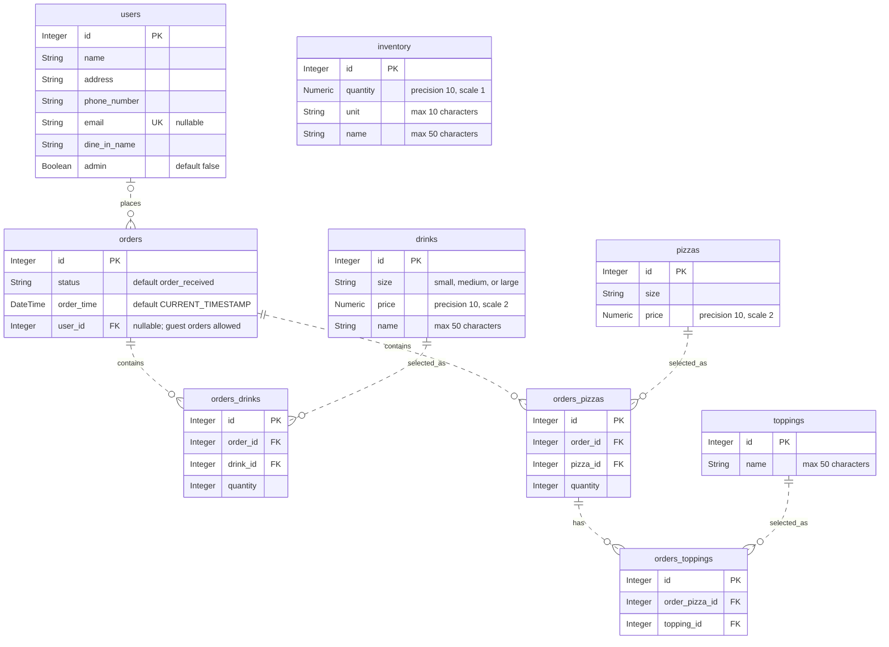

# Luigi's Pizza database

## Database diagram

The tables and foreign keys defined in `models.py` are shown below. `PK` marks
primary keys, `FK` marks foreign keys, and `UK` marks a unique column. All columns
are required unless marked nullable. Relationships show database cardinality:
`o|` means zero or one, `||` means exactly one, and `o{` means zero or many.



The association tables enforce composite uniqueness on
`orders_drinks(order_id, drink_id)`, `orders_pizzas(order_id, pizza_id)`, and
`orders_toppings(order_pizza_id, topping_id)`. Toppings attach to an order's pizza
entry. Inventory has no foreign-key relationships to the other tables.

## Setup

Create the environment and initialize SQLite from PowerShell:

```powershell
python -m venv .venv
.venv/Scripts/python.exe -m pip install -r requirements.txt
.venv/Scripts/python.exe database.py
```

The database is saved as `luigi_pizza.db` beside `database.py`.

Run the tests with `.venv/Scripts/python.exe -m pytest -v`.

Populate an empty database with sample data:

```powershell
.venv/Scripts/python.exe seed.py
```

This creates 20 customers and 100 orders distributed among them, plus pizzas,
drinks, toppings, inventory, and all association records. Every customer has
at least one order. Random choices use a fixed seed for reproducibility.
The script refuses to add data if any table already contains records.
For an empty database created with the older schema, it adds the missing
`orders.user_id` foreign key automatically.

`Order.user` and `User.orders` link customers and orders through `orders.user_id`.
The customer link is optional to preserve support for guest orders.

Orders have a required `status`: `order_received`, `preparing`,
`out_for_delivery`, `ready_for_pickup`, or `completed`. The database enforces
these values and defaults new orders to `order_received`. Required `order_time`
is assigned by SQLite using `CURRENT_TIMESTAMP` (UTC) when inserted; changing
status does not change this timestamp. API responses expose both fields, with
UTC timestamps marked `Z`. POST/PUT accept `status`; omitting it on PUT preserves
the current status. `order_time` is read-only through the API.

For an existing database, run `.venv\Scripts\python migrate_orders.py` before
starting the API. This makes a timestamped SQLite backup, preserves order IDs
and relationships, and assigns existing orders `completed` with the migration
time (their original received times are unknown). Running it again is a no-op.
New databases created with `database.py` already include the new columns.

Running initialization again preserves existing tables and data; it does not
migrate existing schemas.

The `users` table has an automatically assigned integer primary key (`id`),
required text fields (`name`, `address`, `phone_number`, `dine_in_name`),
an optional unique `email`, and a required boolean `admin` defaulting to false.
Phone numbers are text to preserve leading zeros, plus signs, and formatting.
Use `None` for missing emails; multiple users may omit email.
SQLite stores booleans as 0/1; a CHECK constraint rejects other values.

The `pizzas` table has an automatically assigned integer primary key (`id`),
a required text `size`, and a required `price` mapped as `Numeric(10, 2)`.
Use Python `Decimal` values for prices, for example `Decimal("5.00")`.

`OrderPizza` maps `orders_pizzas` with an automatically assigned integer `id`
and required `order_id` and `pizza_id` foreign keys. Each order/pizza pair is
unique. Create entries with `OrderPizza(order=order, pizza=pizza, quantity=1)` or append
them to `order.order_pizzas`. Both `Order.order_pizzas` and
`Pizza.order_pizzas` expose the association objects. `Order.pizzas` and
`Pizza.orders` are read-only convenience relationships that reload after
expiration or commit.

An order may have no pizzas or many pizzas. Pizzas are reusable menu items
and can exist without an order. Each order/pizza link requires a quantity.

The `toppings` table has an automatically assigned integer primary key (`id`)
and a required `name` of up to 50 characters. A CHECK constraint enforces the
length limit because SQLite does not enforce `String(50)` by itself.

`OrderTopping` maps `orders_toppings` with an automatically assigned integer
primary key `id`, a required `order_pizza_id` referencing `orders_pizzas.id`,
and a required `topping_id` referencing `toppings.id`. Each pair is unique.
An order's pizza entry can have zero or many toppings, and a topping can be
reused across entries. Toppings are specific to the order's pizza entry.

Add a topping with
`order_pizza.order_toppings.append(OrderTopping(topping=topping))`.
Use `OrderPizza.order_toppings` and `Topping.order_toppings` to edit links;
`OrderPizza.toppings` and `Topping.order_pizzas` are read-only convenience
relationships that reload after expiration or commit. Removing links keeps
the toppings themselves; ORM deletion of either endpoint cleans up its links.

The `drinks` table has an automatically assigned integer primary key (`id`),
a required `size` restricted to lowercase `small`, `medium`, or `large`,
a required `price` mapped as `Numeric(10, 2)`, and a required `name` of up to
50 characters. CHECK constraints enforce the size and name length limits.

`OrderDrink` maps the `orders_drinks` table with an integer primary key `id`,
required `order_id` and `drink_id` foreign keys, and a required integer `quantity`.
Each order/drink pair is unique. Add and update entries through `order_drinks`:

```python
from decimal import Decimal
from models import Drink, Order, OrderDrink

with SessionLocal.begin() as session:
    order = Order(order_drinks=[
        OrderDrink(
            drink=Drink(size="small", price=Decimal("1.25"), name="Cola"),
            quantity=2,
        ),
    ])
    session.add(order)
```

`Order.drinks` and `Drink.orders` are read-only convenience relationships;
after editing association entries, expire or refresh these collections to
reload them (committing expires them by default). Orders may have no drinks.
Drinks are reusable menu items and can exist without an order.

The `inventory` table has an automatically assigned integer primary key (`id`),
a required `quantity` mapped as `Numeric(10, 1)`, a required `unit` of up to
10 characters, and a required `name` of up to 50 characters. CHECK constraints
enforce both text limits and reject quantities with more than one decimal place.
Use `Decimal` for quantities, for example `Decimal("12.3")`.

Example:

```python
from database import SessionLocal, init_db
from models import User

init_db()
with SessionLocal.begin() as session:
    session.add(User(
        name="Alex Smith",
        address="123 Main Street",
        phone_number="555-0100",
        email="alex@example.com",
        dine_in_name="Alex",
    ))
```

## Sample SQL
```sql
WITH pizza_toppings AS (
    SELECT
        ot.order_pizza_id,
        GROUP_CONCAT(t.name, ', ') AS toppings
    FROM orders_toppings AS ot
    JOIN toppings AS t ON t.id = ot.topping_id
    GROUP BY ot.order_pizza_id
),
pizza_summary AS (
    SELECT
        op.order_id,
        GROUP_CONCAT(
            op.quantity || ' x ' || p.size || ' pizza (' ||
            COALESCE(pt.toppings, 'no extra toppings') ||
            ') - $' || PRINTF('%.2f', p.price * op.quantity),
            '; '
        ) AS pizzas,
        SUM(p.price * op.quantity) AS pizza_total
    FROM orders_pizzas AS op
    JOIN pizzas AS p ON p.id = op.pizza_id
    LEFT JOIN pizza_toppings AS pt ON pt.order_pizza_id = op.id
    GROUP BY op.order_id
),
drink_summary AS (
    SELECT
        od.order_id,
        GROUP_CONCAT(
            od.quantity || ' x ' || d.size || ' ' || d.name ||
            ' - $' || PRINTF('%.2f', d.price * od.quantity),
            '; '
        ) AS drinks,
        SUM(d.price * od.quantity) AS drink_total
    FROM orders_drinks AS od
    JOIN drinks AS d ON d.id = od.drink_id
    GROUP BY od.order_id
)
SELECT
    o.id AS order_number,
    COALESCE(u.name, 'Guest') AS customer,
    COALESCE(u.phone_number, '') AS phone,
    COALESCE(u.email, '') AS email,
    COALESCE(u.address, '') AS address,
    COALESCE(ps.pizzas, 'No pizzas') AS pizzas,
    COALESCE(ds.drinks, 'No drinks') AS drinks,
    PRINTF(
        '$%.2f',
        COALESCE(ps.pizza_total, 0) + COALESCE(ds.drink_total, 0)
    ) AS order_total
FROM orders AS o
LEFT JOIN users AS u ON u.id = o.user_id
LEFT JOIN pizza_summary AS ps ON ps.order_id = o.id
LEFT JOIN drink_summary AS ds ON ds.order_id = o.id
ORDER BY o.id;
```


## HTTP API

Install dependencies and start from the project root:

```powershell
.venv/Scripts/python.exe -m pip install -r requirements.txt
$env:CONNECTIONSTRING = "sqlite:///./luigi_pizza.db"
.venv/Scripts/python.exe -m uvicorn api.main:app --reload
```

`CONNECTIONSTRING` is a SQLAlchemy SQLite URL. If omitted, the API uses
`luigi_pizza.db` in the project root. Startup creates a missing database and
tables, preserving existing data. This does not migrate older schemas.
The parent directory of a configured database must already exist.
Interactive API documentation is available at http://127.0.0.1:8000/docs.

All six resources (`/users`, `/orders`, `/drinks`, `/pizzas`, `/toppings`,
`/inventory`) support POST and GET on the collection, and GET, PUT, DELETE
on `/{id}`. PUT replaces the complete resource; omitted optional fields reset
to defaults. Lists accept `offset` (default 0) and `limit` (default 100, max 1000).
POST returns 201, DELETE returns 204, missing records/references return 404,
invalid input returns 422, and conflicts (including duplicate emails) return 409.
Prices and inventory quantities are returned as decimal strings.

Create menu items and optional users/toppings first, then POST an order:

```json
{
  "user_id": 1,
  "drinks": [{"drink_id": 1, "quantity": 2}],
  "pizzas": [{"pizza_id": 1, "quantity": 1, "topping_ids": [1, 2]}]
}
```

An order must contain drinks, pizzas, or both. Omit `user_id` for guest orders.
Either item list and `topping_ids` may be omitted; toppings default to empty.
Quantities default to 1 and must be positive integers. Each drink/pizza ID may
appear once per order (use quantity for multiples); topping IDs must be unique
within each pizza entry. Toppings belong to that order's pizza, not the menu item.
Order creation and replacement are atomic, including reference validation.

Deleting an order removes its association rows but retains menu items and toppings.
Deleting a menu item or topping still referenced by orders returns 409.
Deleting a user preserves their orders as guest orders. Inventory CRUD stores
stock quantities; orders do not automatically deduct ingredients because the
schema has no ingredient recipe mapping. These endpoints do not implement authentication.

Run the API and database tests:

```powershell
.venv/Scripts/python.exe -m pytest -q
```

API tests use isolated temporary SQLite databases and do not modify production data.
