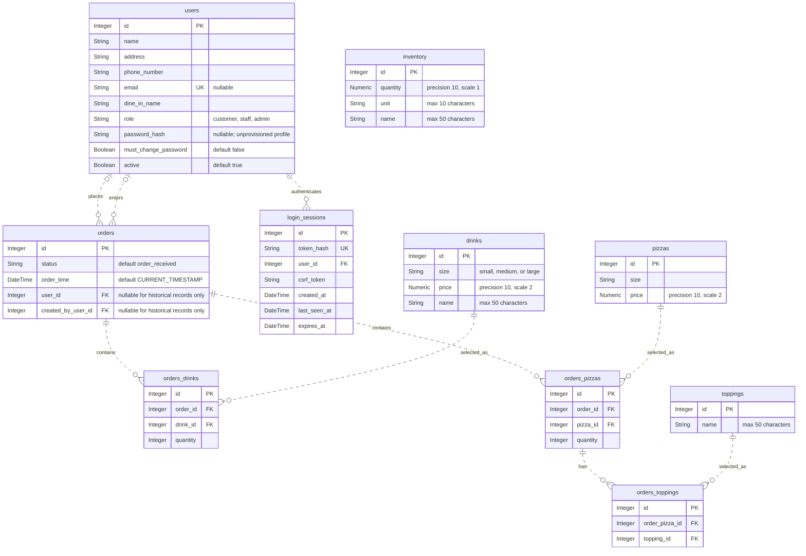

# Luigi's Pizza database

## Package Python sources for deployment

Run `python package_deployment.py` to create `deployment.zip` in the project
directory. Use `python package_deployment.py --output path/to/release.zip` to
choose a different destination. An existing ZIP at that destination is replaced.

The archive contains `.py` files (including tests and the packaging script) and
the project's root `requirements.txt`, preserving their directory structure.
`.venv`, `__pycache__`, and `.git`
directories are skipped at every depth, as are symbolic links. Empty directories
and other non-Python files such as `.env` and databases are omitted.
The script uses only Python's standard library and works from any working directory.

## Database diagram

The tables and foreign keys defined in `models.py` are shown below. `PK` marks
primary keys, `FK` marks foreign keys, and `UK` marks a unique column. All columns
are required unless marked nullable. Relationships show database cardinality:
`o|` means zero or one, `||` means exactly one, and `o{` means zero or many.



The association tables enforce composite uniqueness on
`orders_drinks(order_id, drink_id)`, `orders_pizzas(order_id, pizza_id)`, and
`orders_toppings(order_pizza_id, topping_id)`. Toppings attach to an order's pizza
entry. Inventory has no foreign-key relationships to the other tables.

## Setup

Create the environment and initialize SQLite from PowerShell:

```powershell
python -m venv .venv
.venv/Scripts/python.exe -m pip install -r requirements.txt
.venv/Scripts/python.exe database.py
```

The database is saved as `luigi_pizza.db` beside `database.py`.

Run the tests with `.venv/Scripts/python.exe -m pytest -v`.

Populate an empty database with sample data:

```powershell
.venv/Scripts/python.exe seed.py
```

This creates 20 customers and 100 orders distributed among them, plus pizzas,
drinks, toppings, inventory, and all association records. Every customer has
at least one order. Random choices use a fixed seed for reproducibility.
The script refuses to add data if any table already contains records.
For an empty database created with the older schema, it adds the missing
`orders.user_id` foreign key automatically.

`Order.user` and `User.orders` link customers and orders through `orders.user_id`.
The database permits missing customer/creator links for historical records.
All new API orders require a registered customer and record the submitting user.

Orders have a required `status`: `order_received`, `preparing`,
`out_for_delivery`, `ready_for_pickup`, or `completed`. The database enforces
these values and defaults new orders to `order_received`. Required `order_time`
is assigned by SQLite using `CURRENT_TIMESTAMP` (UTC) when inserted; changing
status does not change this timestamp. API responses expose both fields, with
UTC timestamps marked `Z`. POST/PUT accept `status`; omitting it on PUT preserves
the current status. `order_time` is read-only through the API.

For an existing database, run `.venv\Scripts\python migrate_orders.py` before
starting the API. This makes a timestamped SQLite backup, preserves order IDs
and relationships, and assigns existing orders `completed` with the migration
time (their original received times are unknown). Running it again is a no-op.
New databases created with `database.py` already include the new columns.

Running initialization again preserves existing tables and data; it does not
migrate existing schemas.

The `users` table has an automatically assigned integer primary key (`id`),
required text fields (`name`, `address`, `phone_number`, `dine_in_name`),
an optional unique `email`, and a `role` constrained to `customer`, `staff`, or `admin`.
New API registrations require an email and password; emails are trimmed and lowercased.
Nullable email/password fields preserve old profiles, which cannot log in until provisioned.
Phone numbers are text to preserve leading zeros, plus signs, and formatting.
Seeded customers have no password and cannot log in until explicitly provisioned.
The API never returns password hashes or accepts roles during customer registration.

The `pizzas` table has an automatically assigned integer primary key (`id`),
a required text `size`, and a required `price` mapped as `Numeric(10, 2)`.
Use Python `Decimal` values for prices, for example `Decimal("5.00")`.

`OrderPizza` maps `orders_pizzas` with an automatically assigned integer `id`
and required `order_id` and `pizza_id` foreign keys. Each order/pizza pair is
unique. Create entries with `OrderPizza(order=order, pizza=pizza, quantity=1)` or append
them to `order.order_pizzas`. Both `Order.order_pizzas` and
`Pizza.order_pizzas` expose the association objects. `Order.pizzas` and
`Pizza.orders` are read-only convenience relationships that reload after
expiration or commit.

An order may have no pizzas or many pizzas. Pizzas are reusable menu items
and can exist without an order. Each order/pizza link requires a quantity.

The `toppings` table has an automatically assigned integer primary key (`id`)
and a required `name` of up to 50 characters. A CHECK constraint enforces the
length limit because SQLite does not enforce `String(50)` by itself.

`OrderTopping` maps `orders_toppings` with an automatically assigned integer
primary key `id`, a required `order_pizza_id` referencing `orders_pizzas.id`,
and a required `topping_id` referencing `toppings.id`. Each pair is unique.
An order's pizza entry can have zero or many toppings, and a topping can be
reused across entries. Toppings are specific to the order's pizza entry.

Add a topping with
`order_pizza.order_toppings.append(OrderTopping(topping=topping))`.
Use `OrderPizza.order_toppings` and `Topping.order_toppings` to edit links;
`OrderPizza.toppings` and `Topping.order_pizzas` are read-only convenience
relationships that reload after expiration or commit. Removing links keeps
the toppings themselves; ORM deletion of either endpoint cleans up its links.

The `drinks` table has an automatically assigned integer primary key (`id`),
a required `size` restricted to lowercase `small`, `medium`, or `large`,
a required `price` mapped as `Numeric(10, 2)`, and a required `name` of up to
50 characters. CHECK constraints enforce the size and name length limits.

`OrderDrink` maps the `orders_drinks` table with an integer primary key `id`,
required `order_id` and `drink_id` foreign keys, and a required integer `quantity`.
Each order/drink pair is unique. Add and update entries through `order_drinks`:

```python
from decimal import Decimal
from models import Drink, Order, OrderDrink

with SessionLocal.begin() as session:
    order = Order(order_drinks=[
        OrderDrink(
            drink=Drink(size="small", price=Decimal("1.25"), name="Cola"),
            quantity=2,
        ),
    ])
    session.add(order)
```

`Order.drinks` and `Drink.orders` are read-only convenience relationships;
after editing association entries, expire or refresh these collections to
reload them (committing expires them by default). Orders may have no drinks.
Drinks are reusable menu items and can exist without an order.

The `inventory` table has an automatically assigned integer primary key (`id`),
a required `quantity` mapped as `Numeric(10, 1)`, a required `unit` of up to
10 characters, and a required `name` of up to 50 characters. CHECK constraints
enforce both text limits and reject quantities with more than one decimal place.
Use `Decimal` for quantities, for example `Decimal("12.3")`.

Example:

```python
from database import SessionLocal, init_db
from models import User

init_db()
with SessionLocal.begin() as session:
    session.add(User(
        name="Alex Smith",
        address="123 Main Street",
        phone_number="555-0100",
        email="alex@example.com",
        dine_in_name="Alex",
    ))
```

## Sample SQL
```sql
WITH pizza_toppings AS (
    SELECT
        ot.order_pizza_id,
        GROUP_CONCAT(t.name, ', ') AS toppings
    FROM orders_toppings AS ot
    JOIN toppings AS t ON t.id = ot.topping_id
    GROUP BY ot.order_pizza_id
),
pizza_summary AS (
    SELECT
        op.order_id,
        GROUP_CONCAT(
            op.quantity || ' x ' || p.size || ' pizza (' ||
            COALESCE(pt.toppings, 'no extra toppings') ||
            ') - $' || PRINTF('%.2f', p.price * op.quantity),
            '; '
        ) AS pizzas,
        SUM(p.price * op.quantity) AS pizza_total
    FROM orders_pizzas AS op
    JOIN pizzas AS p ON p.id = op.pizza_id
    LEFT JOIN pizza_toppings AS pt ON pt.order_pizza_id = op.id
    GROUP BY op.order_id
),
drink_summary AS (
    SELECT
        od.order_id,
        GROUP_CONCAT(
            od.quantity || ' x ' || d.size || ' ' || d.name ||
            ' - $' || PRINTF('%.2f', d.price * od.quantity),
            '; '
        ) AS drinks,
        SUM(d.price * od.quantity) AS drink_total
    FROM orders_drinks AS od
    JOIN drinks AS d ON d.id = od.drink_id
    GROUP BY od.order_id
)
SELECT
    o.id AS order_number,
    COALESCE(u.name, 'Guest') AS customer,
    COALESCE(u.phone_number, '') AS phone,
    COALESCE(u.email, '') AS email,
    COALESCE(u.address, '') AS address,
    COALESCE(ps.pizzas, 'No pizzas') AS pizzas,
    COALESCE(ds.drinks, 'No drinks') AS drinks,
    PRINTF(
        '$%.2f',
        COALESCE(ps.pizza_total, 0) + COALESCE(ds.drink_total, 0)
    ) AS order_total
FROM orders AS o
LEFT JOIN users AS u ON u.id = o.user_id
LEFT JOIN pizza_summary AS ps ON ps.order_id = o.id
LEFT JOIN drink_summary AS ds ON ds.order_id = o.id
ORDER BY o.id;
```


## HTTP API and session authentication

Install dependencies and run from the project root. For an **existing database**, stop
any running API process and migrate it first (this creates a timestamped backup):

```powershell
.venv/Scripts/python.exe -m pip install -r requirements.txt
.venv/Scripts/python.exe migrate_auth.py
# For another SQLite file: python migrate_auth.py C:/path/to/your.db
```

Very old databases need `migrate_orders.py` first. New databases need no migration;
startup creates their tables. The authentication migration preserves customer IDs,
order history, and former admin roles. Historical order creators remain unknown (`null`).
Existing profiles are not given shared/default passwords. Case-insensitive duplicate
emails must be resolved before migration. Your existing database is not migrated merely
by updating the source files.

Provision the first administrator using a local command (password is prompted privately):

```powershell
.venv/Scripts/python.exe manage_account.py --email admin@example.com --role admin --name "Restaurant admin"
# For an existing profile, explicitly add --existing to set/reset its credentials.
# To create staff, use --role staff. All provisioned passwords must be changed on login.
```

This command honors `CONNECTIONSTRING`, defaulting to `luigi_pizza.db`. Run the migration
first for an existing database. `--existing` also revokes all sessions and sets the supplied
role; use this local administrative tool only for accounts you intend to provision/reset.
There are no built-in credentials. Passwords must contain 12-128 characters and use Argon2id.

Start the local HTTP server:

```powershell
$env:CONNECTIONSTRING = "sqlite:///./luigi_pizza.db"
$env:COOKIE_SECURE = "false" # Local HTTP only; defaults to true for HTTPS.
$env:APP_ORIGIN = "http://127.0.0.1:8000"
.venv/Scripts/python.exe -m uvicorn api.main:app --reload
```

Environment files are examples; the application does not automatically load `.env`.
`CONNECTIONSTRING` must be a SQLite SQLAlchemy URL. The database parent directory must
already exist. Serve the eventual UI on the same origin, and set `APP_ORIGIN` to the
allowed browser origin(s), separated by commas (scheme, host, and port; no URL paths).
For example: `APP_ORIGIN=https://api.example.com,http://127.0.0.1:8000`.
Whitespace and trailing slashes are ignored. CORS is not enabled. Use `COOKIE_SECURE=true`
and HTTPS outside local development.

### Endpoint permissions

| Endpoint | Access / behavior |
|---|---|
| `POST /auth/register` | Public; always creates a customer with a permanent password |
| `POST /auth/login` | Public; returns user + CSRF token and sets the session cookie |
| `GET /auth/me` | Signed in; returns user + current CSRF token |
| `POST /auth/logout` | Signed in; revokes session and clears cookie |
| `POST /auth/change-password` | Signed in; checks current password, revokes all sessions; log in again |
| `PUT /auth/profile` | Current user edits name, address, phone, dine-in name; no email/role changes |
| `POST /staff/customers` | Staff/admin creates a customer with a temporary password |
| `GET /staff/customers?q=...` | Staff/admin customer lookup by name, email, or phone |
| `GET /admin/users` | Admin lists users |
| `PATCH /admin/users/{id}/access` | Admin sets `role` and `active`; revokes that user's sessions |
| `GET /drinks`, `/pizzas`, `/toppings`, and their `/{id}` routes | Public menu |
| Menu POST/PUT/DELETE and all `/inventory` routes | Staff/admin |
| `POST /orders` | Customer; owner and creator come from the session |
| `POST /staff/orders` | Staff/admin; requires registered customer `user_id`; records staff creator |
| `GET /orders`, `GET /orders/{id}` | Customers see only their own orders; staff/admin see all |
| `PUT /orders/{id}` | Staff/admin replaces items, preserving owner, creator, status, and time |
| `PATCH /orders/{id}/status` | Staff/admin; body contains only `status` |
| `DELETE /orders/{id}` | Admin only |

Public `/users` CRUD was removed. Accounts are disabled, rather than deleted, to preserve
order attribution. Admins cannot change their own access through the API. A staff member
can place a phone order for a newly registered customer before that customer changes
their temporary password. Temporary-password sessions may use `/auth/me`, logout, and
password change; protected business/profile endpoints reject them until the password changes.
Public menu/registration remain public. Customers do not edit or cancel submitted orders
in this version; staff can correct order items.

### Cookies and CSRF (also applies to Postman and API tests)

- Login/registration requests require `X-CSRF-Protection: 1`.
- Login sets `luigi_session` (`HttpOnly`, `SameSite=Lax`, `Secure` by default, host-only).
  The database stores a SHA-256 hash of the random token, not the cookie value.
- Authenticated POST/PUT/PATCH/DELETE requests require the cookie **and** the
  `X-CSRF-Token` value returned by login or `/auth/me`.
- If an `Origin` header is present on a write, it must match an entry in `APP_ORIGIN`. Command-line
  clients may omit Origin; they must still send the required CSRF headers.
- Sessions expire after 8 hours or 30 minutes of inactivity. Login rotates the browser's
  prior session. Logout, password changes, and account access changes revoke sessions.
- `401` means missing/invalid/expired authentication; `403` means insufficient permission,
  required password change, or rejected CSRF/origin. Other customers' orders return `404`.

### Try the API without a UI

Swagger is at `http://127.0.0.1:8000/docs`. Log in using the `X-CSRF-Protection` field;
the browser stores the cookie automatically. Copy `csrf_token` into the `X-CSRF-Token`
field for protected writes. No cookie value needs to be copied into JavaScript.

Alternatively, this PowerShell flow retains cookies automatically. Supply the administrator
email/password provisioned above. For a newly provisioned account, change its password first:

```powershell
$base = "http://127.0.0.1:8000"
$email = Read-Host "Administrator email"
$password = Read-Host "Temporary password" -MaskInput
$auth = Invoke-RestMethod "$base/auth/login" -Method Post -SessionVariable apiSession `
    -ContentType "application/json" -Headers @{"X-CSRF-Protection"="1"} `
    -Body (@{email=$email; password=$password} | ConvertTo-Json)
$newPassword = Read-Host "New password" -MaskInput
Invoke-RestMethod "$base/auth/change-password" -Method Post -WebSession $apiSession `
    -ContentType "application/json" -Headers @{"X-CSRF-Token"=$auth.csrf_token} `
    -Body (@{current_password=$password; new_password=$newPassword} | ConvertTo-Json)
$auth = Invoke-RestMethod "$base/auth/login" -Method Post -SessionVariable apiSession `
    -ContentType "application/json" -Headers @{"X-CSRF-Protection"="1"} `
    -Body (@{email=$email; password=$newPassword} | ConvertTo-Json)
$csrf = @{"X-CSRF-Token"=$auth.csrf_token}

$temporaryPassword = Read-Host "Customer temporary password" -MaskInput
$customer = Invoke-RestMethod "$base/staff/customers" -Method Post -WebSession $apiSession `
    -ContentType "application/json" -Headers $csrf -Body (@{
        name="Alex"; address="123 Main"; phone_number="555-0100"; dine_in_name="Alex"
        email="alex@example.com"; password=$temporaryPassword
    } | ConvertTo-Json)
$pizza = Invoke-RestMethod "$base/pizzas" -Method Post -WebSession $apiSession `
    -ContentType "application/json" -Headers $csrf `
    -Body (@{size="large"; price="9.00"} | ConvertTo-Json)
$order = Invoke-RestMethod "$base/staff/orders" -Method Post -WebSession $apiSession `
    -ContentType "application/json" -Headers $csrf -Body (@{
        user_id=$customer.id; pizzas=@(@{pizza_id=$pizza.id; quantity=1})
    } | ConvertTo-Json -Depth 5)
Invoke-RestMethod "$base/orders/$($order.id)" -WebSession $apiSession
Invoke-RestMethod "$base/auth/logout" -Method Post -WebSession $apiSession -Headers $csrf
```

The example uses PowerShell 7 (`Read-Host -MaskInput`). To test customer self-service,
register at `/auth/register` with the same customer fields, log in, then POST `/orders`
with items only. Neither `user_id` nor `status` is accepted from customers.

Orders require at least one pizza or drink. Quantities are positive integers; duplicate
product IDs and topping IDs are rejected. List endpoints accept `offset` (default 0)
and `limit` (default 100, maximum 1000). Prices/quantities use decimal strings.
Missing records return 404; invalid input 422; conflicts 409. Ordered menu items cannot
be deleted until their order references are removed. Inventory is independent of orders;
there is no automatic ingredient deduction.

### Tests and scope

```powershell
.venv/Scripts/python.exe -m pytest -q
```

Tests use isolated SQLite databases and real API authentication, with no UI and no auth
bypass. They cover catalog/order behavior, registration, temporary passwords, ownership,
roles, CSRF/origin checks, session expiration/revocation, restart persistence, and migration.

This student implementation does not include email verification, self-service password
recovery, login rate limiting, or a full audit trail. The local account command can reset
credentials. For public deployment, add login/registration throttling at a trusted gateway,
terminate HTTPS there, and restrict direct access to the application server. Keep database
files/backups private: they contain customer information, password hashes, and session state.
