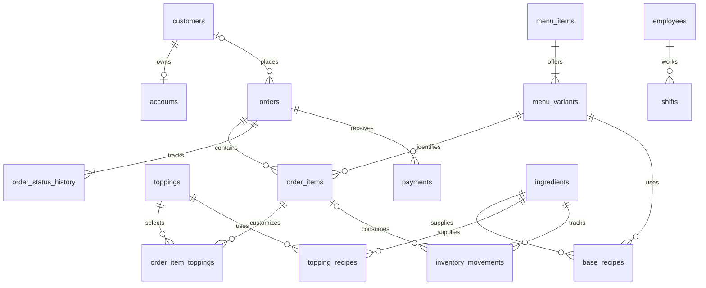

# Luigi's Pizza database

SQLite implementation of the database portion of the supplied requirements. Python's standard library is sufficient; no packages are required.

## Run

```powershell
python init_db.py
python -m unittest -v
```

The supplied `luigi_pizza.db` is already initialized with the menu and store settings. Initialization refuses to overwrite an existing file. To create another database, use `python init_db.py another.db`.

Every application connection must enable `PRAGMA foreign_keys = ON`; `init_db.connect()` does this. The database uses WAL mode and the helper sets a ten-second lock timeout.

## Design

| Area | Tables | Purpose |
|---|---|---|
| Customers | customers, accounts | Optional registered customer, separate login credential record |
| Menu | menu_items, menu_variants, toppings | Products, size-specific prices, topping choices |
| Ordering | orders, order_items, order_item_toppings | Guest or account orders, multiple pizzas/drinks, individually customized lines |
| Tracking | order_status_history | Automatically records initial status and subsequent status changes |
| Inventory | ingredients, base_recipes, topping_recipes, inventory_movements | Exact integer quantities and auditable stock changes |
| Staff | employees, shifts | Staff roster, shift rate snapshots and actual minutes worked |
| Finance | payments, expenses | Payments/refunds and other operating expenses |
| Operations | store_hours, kitchen_settings | Daily hours, oven capacity and bake duration |

Relationships:



Menu and recipe data are normalized. Order lines intentionally snapshot names, sizes and prices so later menu price edits do not alter prior sales. Orders snapshot tax rates; shifts snapshot hourly wages. Identical pizzas can share a line with quantity greater than one; pizzas with different toppings require separate lines. Each selected topping is charged once per pizza on that line.

All money is integer cents. The requirements' tax rate is stored as 925 basis points (9.25%); this is a project input, not a jurisdictional tax determination. `order_totals` calculates tax once on the subtotal, rounding half up to the nearest cent. Both pizzas and beverages are assumed taxable. Ingredient quantities use a single chosen integer unit per ingredient (for example milligrams or milliliters), including recipes, purchases and consumption.

## Included queries

```sql
SELECT * FROM order_totals WHERE order_id = 1;
SELECT * FROM order_status_history WHERE order_id = 1 ORDER BY event_id;
SELECT * FROM inventory_levels WHERE quantity_on_hand <= reorder_level;
SELECT * FROM daily_sales ORDER BY sales_date;
SELECT * FROM payroll_summary;
```

`daily_sales` reports completed orders by their UTC creation date, before refunds. It is a sales report, not net profit or cash reconciliation. `payroll_summary` reports rounded gross pay per shift, without overtime, withholding, benefits or payroll tax. NULL worked minutes mean the shift has not been finalized.

## Seed data and open decisions

- Regular crust pizza: 12-inch/$5, 14-inch/$7, 18-inch/$9; marinara and cheese included.
- Nine specified toppings; per-topping prices $1/$2/$3 by size. **Large topping price is provisional**, matching the assumption in the supplied document.
- Coca-Cola fountain drink, Iced Tea and Dr. Pepper at $1/$2/$3. Specific Coca-Cola flavors remain unspecified.
- Hours are 10:00–23:00 every day; weekday 0 means Sunday. Hours are local store time; timestamps elsewhere use UTC in `YYYY-MM-DD HH:MM:SS` format.
- Oven setting: two large pizzas, eight-minute bake duration. Smaller-pizza capacity, preparation times and queue scheduling remain unspecified.
- Guest orders are allowed; customer profiles and accounts are optional. Orders require a customer name, and dine-in orders also require a dine-in name. Address and phone are nullable because fulfillment does not require delivery; mandatory profile fields can be tightened once clarified.
- Exact recipes are deliberately not seeded: “sauce, cheese, etc.” in cups does not specify all ingredients or measurable stock units. Define and verify those recipes before enabling stock consumption. No invented opening stock, employee identities, wages or credentials are supplied.
- Reward numbers are supported; earning/redemption rules remain undefined.

## Application responsibilities for the next phase

This deliverable is a database, not a completed ordering service. SQLite enforces foreign keys, basic value constraints, topping eligibility and automatic status history. The application must implement these workflows:

1. In a single transaction, validate the active menu and requested sizes, copy current prices and names to order lines, and add toppings. Require at least one line before accepting an order. Prevent changes to accepted financial snapshots; use explicit refunds/corrections instead.
2. Use `BEGIN IMMEDIATE` for stock allocation: validate every required recipe, aggregate required quantities across the whole order, check available stock, and insert consumption movements atomically with the order action. Make retries idempotent. Persist actual consumption quantities so later recipe edits cannot rewrite usage. Stock may currently go negative through direct SQL; the schema does not implement reservation or automatic consumption.
3. Validate status transitions, store hours, payment amounts, refunds and authorization. A cancelled order does not automatically imply ingredients can be returned to stock. Payment rows represent confirmed transactions; store processor references only, never raw card data.
4. Compute ready-time estimates from the queue and actual preparation/bake capacity; maintain `estimated_ready_at`. An eight-minute bake duration alone is not an accurate completion estimate.
5. Enforce shift overlap rules and the two-to-four simultaneous employee requirement in scheduling logic; roster size is not hard-coded. Capture actual worked time and validate timestamps. The database compares shift timestamps lexically, so callers must use the documented format.
6. Hash passwords using a suitable password-hashing library before insertion. The database stores a hash string, and does not itself perform authentication or hashing.
7. Build financial reporting with a defined accounting policy: distinguish tax liabilities, refunds, ingredient consumption costs, inventory purchases, payroll and other expenses to avoid double-counting. Populate movement costs when recording consumption. Forecasts require accumulated sales history.

SQLite supports this initial single-store design. Population size alone does not establish load capacity; benchmark expected concurrent ordering traffic. SQLite permits one writer at a time, so keep transactions short and plan a server database migration if measured concurrency requires it. Use SQLite's backup API for consistent backups of a running WAL database.

## Verification

`test_database.py` creates isolated temporary databases and checks seeded data, foreign keys, invalid values, drink topping rejection, price snapshots, order tax, status history, inventory arithmetic, payroll arithmetic and overwrite protection. These tests verify database behavior; they do not validate the future service workflows above.
