# Relational database design

> This document describes the original 30-table normalized SQL analysis design, not the current integrated runtime schema. See the [current database diagram](runtime-database.md) for the eleven tables used by the integrated application and the [integration notes](integration.md) for mappings and transactions. Do not load the reference schema into the integrated database.

## Conventions and normalization

`schema.sql` targets SQLite 3. Enable `PRAGMA foreign_keys=ON` for every connection. Identifiers are integer primary keys; customer emails, order numbers, submission keys, and promotion codes have unique constraints. Money is integer cents. Ingredient amounts are real cup/unit quantities; production can use fixed precision or scaled integer measures to avoid floating-point drift. Times are UTC strings in SQL; the browser displays local time. Use consistent ISO timestamps in a production API.

Each table describes one entity or relationship. Lookup tables separate sizes, toppings, roles, and suppliers. Junction tables express many-to-many relationships. Historical order contact/address/price snapshots are intentional business records, not duplicate current profiles: changing a customer address or menu price must not alter a past sale. A single order subtotal/total is also retained as an auditable financial snapshot; the server must reconcile it with item prices in the transaction.

## Tables, keys and relationships

| Tables | Primary key | Main relationships / purpose |
|---|---|---|
| branches | branch_id | One-to-many employees, inventory, shifts and orders; hours and location. |
| customers | customer_id | One-to-many addresses, orders and support tickets; unique email. |
| customer_addresses | address_id | customer_id FK; multiple saved addresses per customer. |
| employee_roles | role_id | One-to-many employees; administrator/branch role lookup. |
| employees | employee_id | branch_id and role_id FKs; fictional directory, contact, position, hire/status. |
| employee_shifts | shift_id | employee_id and branch_id FKs; clock timestamps. Optional verified_by employee FK and verified_at timestamp record administrator review of closed shifts. Partial unique index prohibits two open shifts for one employee. Hours are calculated, not duplicated. |
| employee_pay | pay_id | employee_id FK; effective-dated pay. Restricted server access. |
| employee_benefits | benefit_id | employee_id FK; benefit enrollments/dates. Restricted server access. |
| pizza_sizes | size_id | Base/topping/drink cents by size and diameter. One-to-many recipes/items. |
| menu_items | menu_item_id | Pizza base/drink products and availability; one-to-many recipes/items. |
| toppings | topping_id | Reusable topping choices; many-to-many order items through order_item_toppings. |
| ingredients | ingredient_id | Name/category/unit; many-to-many recipes and branch stocks. |
| suppliers | supplier_id | One-to-many inventory supplier references. |
| inventory | (branch_id, ingredient_id) | Branch–ingredient junction with stock, threshold, supplier/restock date. Composite FKs bind movements to exact branch stock. |
| recipes | recipe_id | Exactly one menu_item_id OR topping_id plus size_id; unique recipe for each product/topping size. |
| recipe_components | (recipe_id, ingredient_id) | Recipe–ingredient many-to-many junction; positive quantity in ingredient units. |
| orders | order_id | Unique number/submission key; customer_id, branch_id and optional promotion_id FKs; status, timestamps, totals. |
| order_contacts | order_id | One-to-one immutable customer contact snapshot. |
| order_delivery_addresses | order_id | One-to-one delivery address snapshot where applicable. |
| order_items | order_item_id | order_id/menu_item_id/size_id FKs; ordered quantity and unit price snapshot including toppings. |
| order_item_toppings | (order_item_id, topping_id) | Topping selection and charged per-topping price snapshot. Do not add this charge again to item unit price. |
| order_status_events | event_id | order_id and optional employee_id FKs; future status audit history. |
| inventory_movements | movement_id | Composite stock FK plus optional order_id; signed stock deltas, reason and time. Unique per-order ingredient deduction. |
| payments | payment_id | order_id FK; simulated/provider payment result. Contains references, never card numbers. |
| rewards_accounts | customer_id | One-to-one customer reward membership and opening balance. |
| rewards_transactions | transaction_id | Customer account and optional order FKs; signed earned/redeemed points. Partial uniqueness prevents duplicate earn entries. |
| promotions | promotion_id | Unique code, discount/type/points/minimum/dates/status. |
| customer_promotions | (customer_id, promotion_id) | Customer–promotion many-to-many assignment and optional redeemed order. Future targeting/single-use semantics. |
| support_tickets | ticket_id | Customer/order/assigned employee FKs; number, customer-name snapshot, issue/description/summary/time/status. |
| support_messages | message_id | ticket_id FK; one-to-many attributed conversation messages. |

`rewards_balances` is a view, not a table: opening points + the transaction ledger. The browser uses a cached balance for simplicity; a backend should treat the ledger as authoritative or maintain an equivalent balance transactionally.

## Core relationships

- A customer places many orders; an order has exactly one customer and one branch.
- An order contains many items; each item chooses one product and one size. Many items may select the same topping; each selection is represented once in the junction table.
- Base pizza recipes contain marinara/cheese amounts by size (¼, ½, 1 cup). Topping recipes contain independent portions (⅛, ¼, ½ cup in the demo). Drink recipes contain one beverage inventory unit. Extra cheese points to the same cheese ingredient.
- Inventory belongs to a branch; recipes are shared specifications. Sum recipe components times item quantities, then debit that branch’s stock. Price never determines ingredient demand.
- Employees have a role and assigned branch; shifts also record where work occurred so future cross-branch coverage is representable.
- Rewards belong to customers and link earned/redeemed transactions to orders. Promotions can be assigned to many customers.
- Support tickets belong to customers and optionally an order. Messages preserve the conversation; staff assignment/status supports escalation handoff.

## ER diagram

```mermaid
erDiagram
  branches ||--o{ employees : assigns
  employee_roles ||--o{ employees : defines
  employees ||--o{ employee_shifts : clocks
  branches ||--o{ employee_shifts : hosts
  employees ||--o{ employee_pay : receives
  employees ||--o{ employee_benefits : enrolls
  customers ||--o{ customer_addresses : saves
  customers ||--o{ orders : places
  branches ||--o{ orders : fulfills
  orders ||--|| order_contacts : snapshots
  orders ||--o| order_delivery_addresses : delivers_to
  orders ||--|{ order_items : contains
  menu_items ||--o{ order_items : supplies
  pizza_sizes ||--o{ order_items : sizes
  order_items ||--o{ order_item_toppings : selects
  toppings ||--o{ order_item_toppings : decorates
  menu_items o|--o{ recipes : specifies
  toppings o|--o{ recipes : specifies
  pizza_sizes ||--o{ recipes : portions
  recipes ||--|{ recipe_components : contains
  ingredients ||--o{ recipe_components : uses
  branches ||--o{ inventory : stocks
  ingredients ||--o{ inventory : stocked_as
  suppliers o|--o{ inventory : supplies
  inventory ||--o{ inventory_movements : records
  orders o|--o{ inventory_movements : consumes
  orders ||--o{ order_status_events : progresses
  employees o|--o{ order_status_events : updates
  orders ||--o{ payments : settles
  customers ||--o| rewards_accounts : joins
  rewards_accounts ||--o{ rewards_transactions : accrues
  orders o|--o{ rewards_transactions : earns
  customers ||--o{ customer_promotions : receives
  promotions ||--o{ customer_promotions : assigns
  promotions o|--o{ orders : discounts
  customers ||--o{ support_tickets : raises
  orders o|--o{ support_tickets : concerns
  employees o|--o{ support_tickets : reviews
  support_tickets ||--o{ support_messages : preserves
```

The diagram expresses application cardinalities. An SQL foreign key cannot alone require an order to have items, a delivery order to have an address, or a recipe to have a component. The API must enforce those cross-row rules atomically.

## Required server transaction

1. Authenticate the customer; enforce branch availability, hours and permissions server-side.
2. Find an existing order by submission key before doing work, to make retries idempotent.
3. Validate a nonempty order, quantities, product/topping IDs, current prices and delivery contact/address.
4. Validate dates/minimums/reward eligibility for the selected offer.
5. Calculate item/order cents from authoritative menu data; aggregate recipe quantities.
6. Lock/check stock for all affected branch ingredients and reject if insufficient. With SQLite, use an appropriate transaction such as `BEGIN IMMEDIATE`; production database locking semantics may differ.
7. Insert order, contacts/address snapshots, items and topping charges. Debit stock and write movement records. Debit/credit reward ledger entries and record payment state without card data.
8. Commit once; rollback every change if any step fails. Payment provider coordination needs a reliable idempotent workflow/outbox because an external payment cannot be part of a local SQL transaction.

Update status events separately without repeating inventory deductions. Cancellation/refund workflows need auditable stock/reward reversal rules; those are modeled but not implemented by this front-end.

## Indexes and privacy

Indexes match branch/status/date order queues, customer order history, item lookup, shifts and ticket review. Paginate and filter on the server at scale. Payroll/benefits tables must never appear in public menu/customer responses. SQL constraints support integrity, not authentication; SQLite has no built-in app-level role enforcement. Restrict database files and APIs and audit sensitive access.

## Verification

Run `python scripts/check_database.py`. It executes schema and seeds in memory, verifies foreign keys/integrity, required prices/portions, nonempty seeded orders, delivery addresses and line subtotals, and rejects negative stock, orphan items, inconsistent totals and duplicate open shifts. Browser fixtures and SQL seed are intentionally independent.
