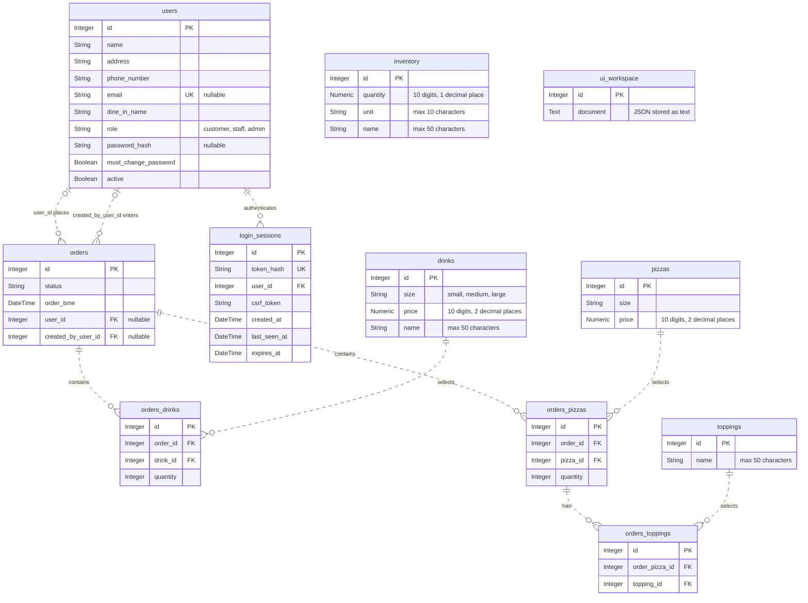

# Current database design

This diagram describes the integrated application on this branch. The active schema has eleven tables: ten from the team's models in `backend/models.py` and the added `ui_workspace` table in `backend/integration.py`. Startup creates them in `backend/luigi_pizza.db`.

The team's original README has been kept as supplied. This document records the current design without changing their documentation. The separate 30-table schema in `database/schema.sql` remains an analysis reference.

## Database diagram

`PK` means primary key, `FK` means foreign key, and `UK` means a unique column. Each relationship connects a child record to one parent, except the two nullable user references on an order. A parent may have zero or more child records. The two user/order relationships refer to different columns.

Inventory and the workspace have no database foreign keys, so the diagram shows them without relationship lines. Their connections to other records are managed by the integration code.

## Constraints and order lines

- `orders_drinks` keeps a unique `(order_id, drink_id)` pair. Repeated selections of the same drink product are combined into one line with a quantity.
- `orders_toppings` keeps a unique `(order_pizza_id, topping_id)` pair. A topping appears once per pizza line.
- `orders_pizzas` no longer has a unique `(order_id, pizza_id)` pair. Two large pizzas with different toppings can be saved as separate lines. The original standalone API still applies its own input validation.
- User emails and session token hashes are unique. User roles and stored order statuses have check constraints in the team models.
- Inventory quantities retain one decimal place. Ingredients shown in cups are converted to eighth-cup units before being saved: one cup becomes `8.0`. Drink stock uses units.

## What the workspace stores

The integration uses the workspace row with ID `1` to store a JSON document. These records are not separate SQL tables:

| Records in the document | Connection to the team tables |
|---|---|
| Branches, employees, and shifts | Employee `apiUserId` values refer to `users.id`; branch and shift references are managed in the document. |
| Order details, totals, and display numbers | Each integrated order's `apiOrderId` refers to `orders.id`; its pizza, drink, and topping lines are also saved in the team tables. |
| Branch inventory and recipes | Mapping entries refer to `inventory.id`; stock changes update both representations. |
| Customer metadata and rewards | Customer mappings refer to `users.id`; balances and reward history remain in the document. |
| Promotions and support tickets | References to customers, orders, and branches are managed in the document. |

These references are application-managed mappings, not SQL foreign-key constraints. The command handler updates the team tables and workspace in one transaction. It returns only the records the signed-in customer, employee, or administrator is permitted to see.

Future work can move the workspace records into dedicated relational tables. That would require a migration; the reference SQL design is not automatically applied by the current app. An older database that still has the unique order/pizza constraint also needs a reviewed migration before it can be used with this integration.

See the [integration notes](integration.md) for field mappings and the [main README](../README.md) for setup instructions.
